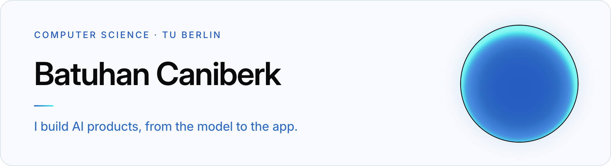
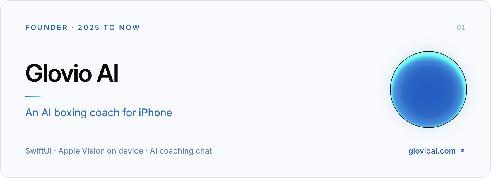
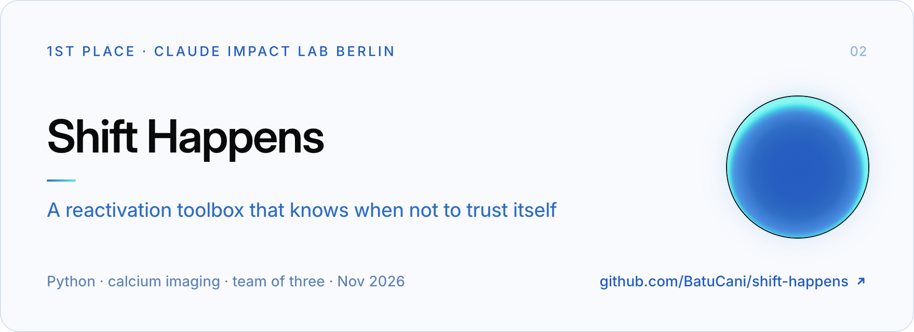
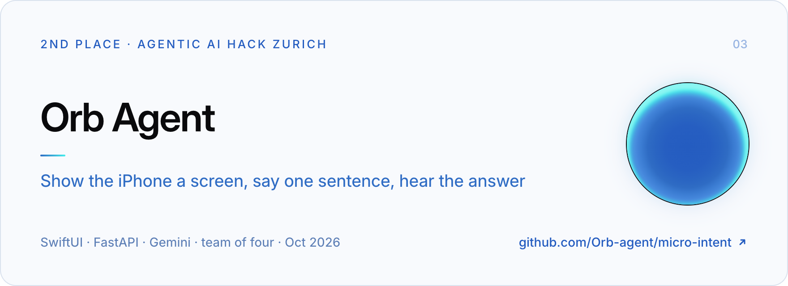
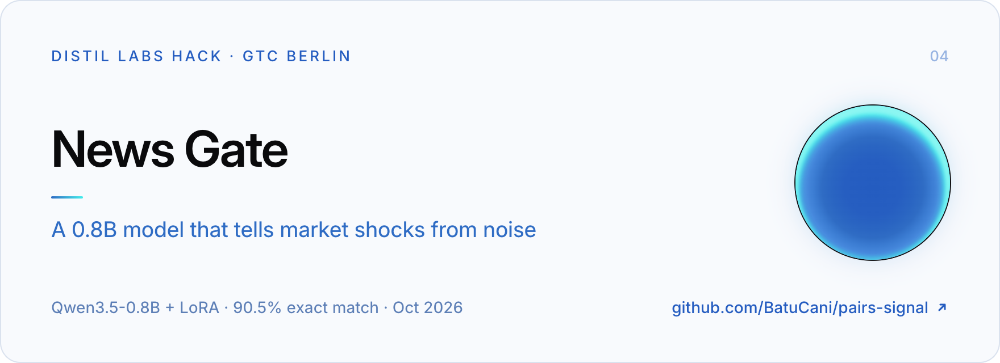
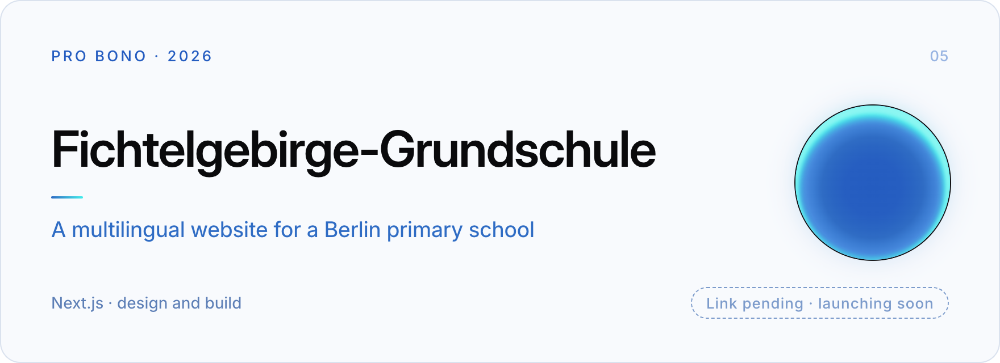
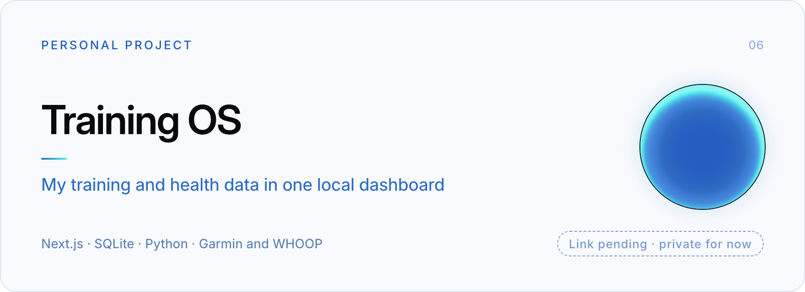

  <picture>
    <source media="(prefers-color-scheme: dark)" srcset="https://raw.githubusercontent.com/BatuCani/BatuCani/HEAD/assets/banner-dark.png">
    
  </picture>

I'm Batu.
I study computer science at TU Berlin, focused on AI and machine learning, and I founded Glovio AI.
I build products end to end, usually alone or in a small hackathon team.
Most of that work sits in private repositories, so this profile shows only a slice of it.
Below are six projects, linked wherever the code or the product is public.

## Selected work

  <a href="https://glovioai.com">
    <picture>
      <source media="(prefers-color-scheme: dark)" srcset="https://raw.githubusercontent.com/BatuCani/BatuCani/HEAD/assets/glovio-dark.png">
      
    </picture>
  </a>

**[Glovio AI](https://glovioai.com).**
I founded Glovio and build its iOS app: a boxing coach in SwiftUI that reads your technique on device with Apple Vision and talks it through with you in an AI coaching chat.
I also handle distribution; the videos reached 30 million views in one month and brought in more than 500 waitlist sign-ups.

  <a href="https://github.com/BatuCani/shift-happens">
    <picture>
      <source media="(prefers-color-scheme: dark)" srcset="https://raw.githubusercontent.com/BatuCani/BatuCani/HEAD/assets/shift-happens-dark.png">
      
    </picture>
  </a>

**[Shift Happens](https://github.com/BatuCani/shift-happens)**, 1st place at Claude Impact Lab Berlin, November 2026.
With two teammates I asked whether sleep reactivation, the brain replaying a task while it sleeps, can be measured in slow calcium-imaging data at all.
The toolbox tests four standard methods against planted-truth controls before any of them gets a vote.
On the one public calcium session it answers "not enough evidence" instead of guessing, and on rat recordings with known reactivation it says yes.
I built the data loader, two of the four methods and the submission, which we entered as ReacDetect.
[Live app](https://batucani.github.io/shift-happens/app/).

  <a href="https://github.com/Orb-agent/micro-intent">
    <picture>
      <source media="(prefers-color-scheme: dark)" srcset="https://raw.githubusercontent.com/BatuCani/BatuCani/HEAD/assets/orb-agent-dark.png">
      
    </picture>
  </a>

**[Orb Agent](https://github.com/Orb-agent/micro-intent)**, 2nd place at the Tech Europe Agentic AI Hack in Zurich, October 2026.
Built in one day with a team of four: an iPhone voice assistant for older people.
You show it a screen, say one sentence and hear a spoken answer, with cards for calendar clashes, trains and flights.
It only reads your accounts, and any change waits for a yes.

  <a href="https://github.com/BatuCani/pairs-signal">
    <picture>
      <source media="(prefers-color-scheme: dark)" srcset="https://raw.githubusercontent.com/BatuCani/BatuCani/HEAD/assets/news-gate-dark.png">
      
    </picture>
  </a>

**[News Gate](https://github.com/BatuCani/pairs-signal)**, built at the distil labs hack at GTC Berlin Builders Night, October 2026.
A Qwen3.5-0.8B fine-tuned with LoRA that reads a stock headline, names the event type and calls it a real shock or noise.
On 400 held-out headlines it gets 90.5% exact match, ahead of its own GLM 5.3 teacher (79.3%) and the untuned base model (55.8%).
[Live demo](https://news-gate.vercel.app).

  <picture>
    <source media="(prefers-color-scheme: dark)" srcset="https://raw.githubusercontent.com/BatuCani/BatuCani/HEAD/assets/fichtelgebirge-dark.png">
    
  </picture>

**Fichtelgebirge-Grundschule**, pro bono, 2026.
I design and build the new multilingual website of a primary school in Berlin, in Next.js.
*Link pending: the site launches soon.*
<!-- PENDING: add the school site URL here and as the card link once it is live. -->

  <picture>
    <source media="(prefers-color-scheme: dark)" srcset="https://raw.githubusercontent.com/BatuCani/BatuCani/HEAD/assets/training-os-dark.png">
    
  </picture>

**Training OS**, a personal project.
It brings my Garmin and WHOOP data into one local SQLite database, shows it in a Next.js dashboard and serves an iPhone app through a versioned API.
When a number is missing or stale, it says so instead of guessing.
*Link pending: the code is private for now.*
<!-- PENDING: link a public repo or write-up here if one is published. -->

## How I work

Swift for iOS, Python for models and data, TypeScript for the web.
I decide what would count as a result before I run anything, and I keep the predictions that failed next to the ones that held.
A small model has to beat a fixed held-out set before I trust it.
Most days I run several coding agents in parallel and keep the product calls, the feel and the final review for myself.

## Elsewhere

Glovio AI at [glovioai.com](https://glovioai.com) · Personal site and email: pending
<!-- PENDING: personal site URL and a public email address. -->

