  <picture>
    <source media="(prefers-color-scheme: dark)" srcset="https://raw.githubusercontent.com/BatuCani/BatuCani/output/contrib-dark.svg">
    
  </picture>

  <picture>
    <source media="(prefers-color-scheme: dark)" srcset="https://raw.githubusercontent.com/BatuCani/BatuCani/HEAD/assets/banner-batuhan-dark.png">
    
  </picture>

I'm Batu.
I study computer science at TU Berlin, focused on AI and machine learning, and I founded Glovio AI.
I build products end to end, from the model to the app, usually alone or in a small hackathon team.

Most of what I build lives in private repositories, so this profile is a lot emptier than what I actually work on.
